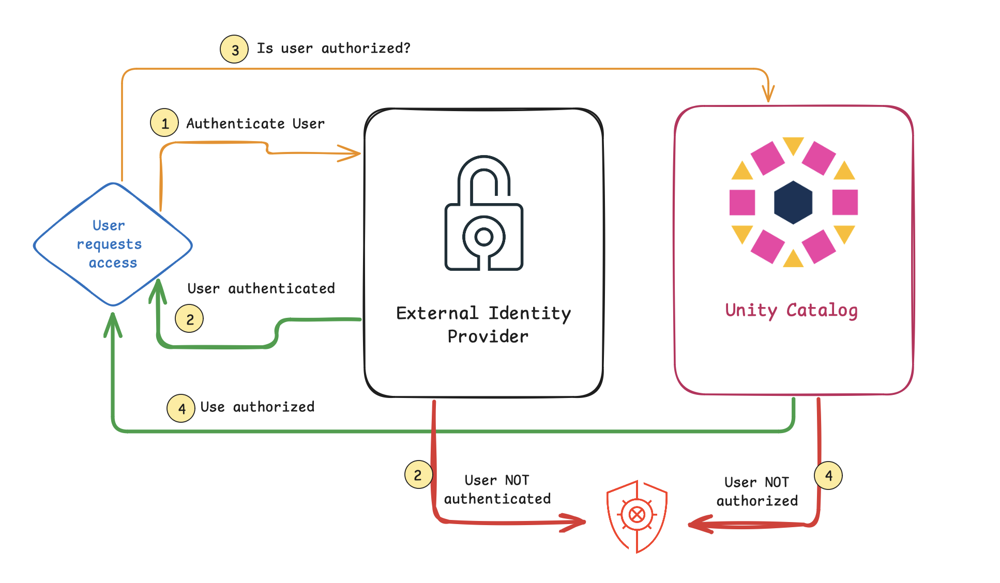
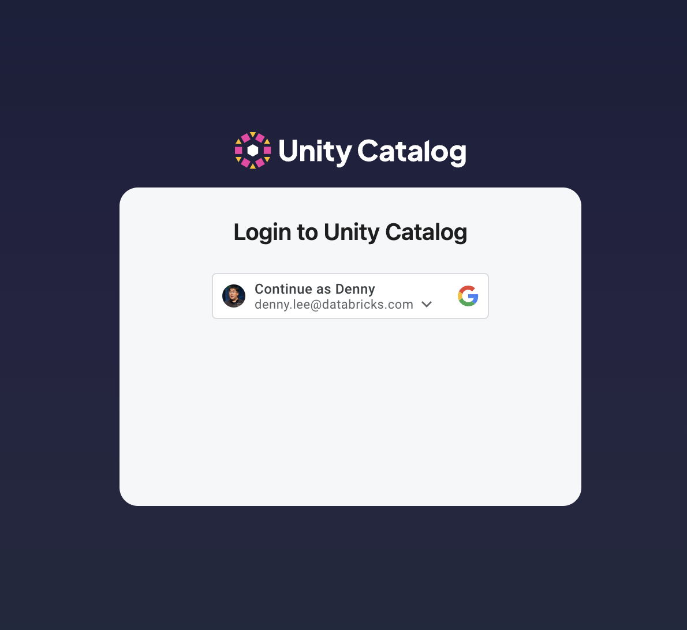
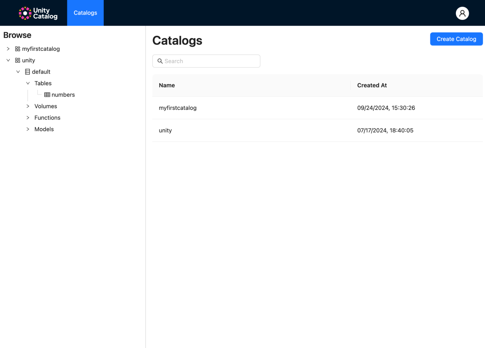
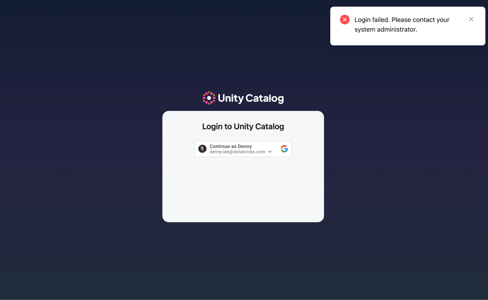
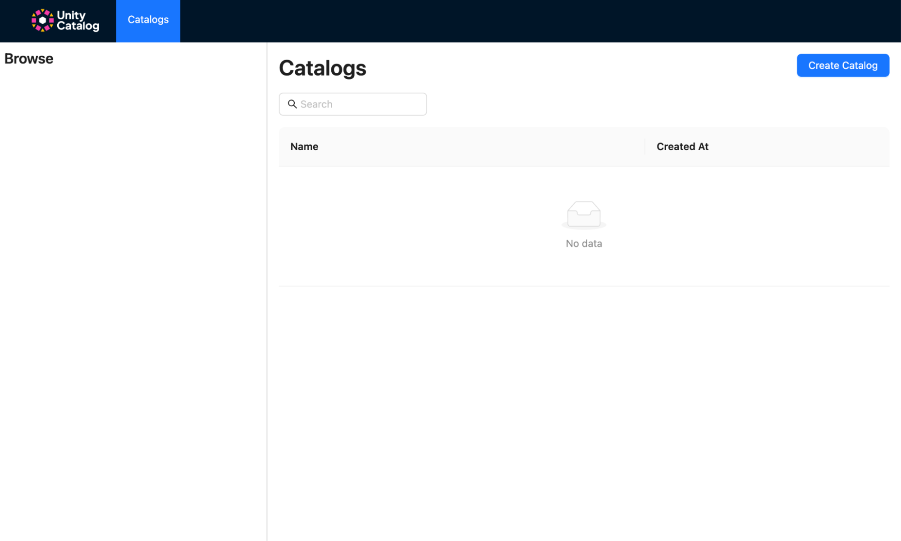

# Unity Catalog Authentication and Authorization

You can start working with Unity Catalog Access Control integration with an external authentication provider
(e.g., Google Auth, Okta, etc.) via the following instructions.

It is important to note that Unity Catalog already has its own local user database to restrict user access. When you
work with an external authentication provider, we are now relying on that external provider (e.g., Google Identity)
to authenticate. For example, for access to Unity Catalog authenticated by Google Identity, a user must have a
Google Identity (e.g. gmail address) that is added to the local UC database.



Throughout the next set of examples, we are using an external identity provider for authentication while the local
Unity Catalog database for authorization. The flow is as follows:

1. The user account used will **authenticate** against an external authentication provider to confirm the user is who
    they say they are (e.g., `bobbie@rocinante` is in fact Bobbie Draper on the Rocinante)
2. The user account is either **authenticated** and a *user token is provided* or **not authenticated**.
3. With the token at hand, the user account also needs to request if they are **authorized** to perform the task
    (e.g., the user can only read tables but not write any tables).  This authorization step is performed with the
    Unity Catalog database.
4. The user account is either **authorized** and they can perform the task or **not authorized**.

## Configure your External Identity Provider

To try out authentication and authorization, first configure your preferred external identity provider following their
instructions. Ultimately you will have configuration properties to configure:

* `etc/conf/server.properties` to fill in the Identity Provider authorization parameters
* [Optional] `ui/.env` so the [Unity Catalog UI](../usage/ui.md) can also use the same `client_id`.  

!!! note "Unity Catalog UI supported Identity Authentication Providers"
    Currently, the Unity Catalog User Interface supports Google Identity Provider.

You can follow [these instructions](./google-auth.md) if would like to use Google as your external identity provider.

Once you have configured your identity provider, the next step is to configure your Unity Catalog server settings.

## Configure UC Server Settings

Start by editing `etc/conf/server.properties` with the **Client ID** and **Client secret** provided to you by the
Identity Provider.

```sh
server.authorization=enable
server.authorization-url=https://accounts.google.com/o/oauth2/auth
server.token-url=https://oauth2.googleapis.com/token
server.client-id=<Client ID provided earlier>
server.client-secret=<Client secret provided earlier>
server.allowed-issuers=https://accounts.google.com
server.allowed-jwks-uris=https://www.googleapis.com/oauth2/v3/certs
server.audiences=<Client ID provided earlier>
```

### Issuer and Audience Validation

When authorization is enabled, the server validates incoming identity tokens against configured issuers and audiences:

- **server.allowed-issuers**: Comma-separated list of allowed token issuers (exact match or wildcard with `*`). Tokens from issuers not in this list will be rejected. This prevents attackers from using their own identity provider to forge tokens.
- **server.allowed-jwks-uris**: Comma-separated list of exact JWKS URLs on other origins. By default, the discovery document's `jwks_uri` must use the issuer's scheme, host, and port. Set this property when the provider publishes keys on another origin. For example, Google requires `https://www.googleapis.com/oauth2/v3/certs`. Match the URL from discovery, including any explicit port; `https://host:443/certs` differs from `https://host/certs`. Wildcards are not supported. HTTPS issuers require HTTPS key URLs, even for configured URLs. HTTP issuers can use HTTP key URLs for local or private providers. Restart the server after changing this property.
  Each entry must be an absolute HTTP or HTTPS URL without credentials or a fragment.
  An invalid entry prevents server startup, even when authorization is disabled.
- **server.audiences**: Comma-separated list of expected JWT audience values. Tokens must contain an `aud` value matching one of these entries (exact match or wildcard with `*`). A single value of `*` disables audience validation (issuer and user checks still apply); that sentinel cannot be combined with other values.

#### Programmatic exchange (service principals)

Service integrations exchange an upstream OAuth access token on `POST /auth/tokens` without client credentials on the UC request. UC resolves the principal as follows:

1. **Email mode** — look up the user by the token `email` claim (or `sub` fallback). CLI and browser `id_token` exchange uses this path only; `azp` / `client_id` is not used, because that claim identifies the OAuth application, not the human.
2. **External id mode** — for `access_token` subjects, look up the user by OAuth client id (`azp`, or `client_id`) mapped to `externalId`. When the access token has no `email` claim, this is tried before `sub`.

Create UC users with a human-readable `email` for grants and set `externalId` to the OAuth client id for programmatic exchange. The issued UC access token always uses the resolved user's `email`.

#### Browser cookie authentication

The authentication cookie uses `Secure`, `HttpOnly`, and `SameSite=Strict`.
Send `X-Requested-With: XMLHttpRequest` when requesting a cookie with
`POST /auth/tokens?ext=cookie`.
With authorization enabled, cookie-authenticated requests also need it,
except GET, HEAD, and OPTIONS. A missing or incorrect header returns HTTP 403 `PERMISSION_DENIED`.
The UI sends the header automatically. Cookie-based scripts must add it to writes.
Clients that use `Authorization: Bearer <token>` do not need this header.
Cross-origin browser requests with this header need CORS preflight approval.
The server does not enable cross-origin access.

#### Multiple Identity Providers

You can configure multiple issuers and audiences by separating them with commas:

```properties
server.allowed-issuers=https://accounts.google.com,https://login.microsoftonline.com/{tenant-id}/v2.0
server.allowed-jwks-uris=https://www.googleapis.com/oauth2/v3/certs
server.audiences=your-google-client-id,your-azure-client-id
```

Wildcard issuers match a single DNS label per `*`:

```properties
server.allowed-issuers=https://*.dev.example.com
```

Wildcard audience patterns use the same `*` rules. For example, `https://*.dev.example.com`
accepts tokens whose `aud` includes `https://dev.dev.example.com` or
`https://backend.dev.example.com`:

```properties
server.audiences=unity-catalog-local,https://*.dev.example.com
```

When the identity provider issues per-client UUID audiences that cannot be pre-listed (for example
dynamic OAuth client IDs in `id_token.aud`), use `*` alone to skip audience validation while still
enforcing issuer and user checks:

```properties
server.audiences=*
server.allowed-issuers=https://*.dev.example.com
```

#### Wildcard issuer security

With exact-match issuers, the server only fetches JWKS from a fixed set of identity providers.
Wildcard issuer patterns such as `https://*.dev.example.com` are evaluated **before** signature
verification: a token whose `iss` matches the pattern determines which host the server contacts
for OIDC discovery and JWKS. An unauthenticated caller who can mint tokens with arbitrary `iss`
values under that pattern can steer JWKS fetches (an SSRF-style surface).

Use wildcard issuers only where necessary, only for domains you control, and avoid patterns that
cover internal or sensitive hosts. Prefer exact issuer URLs and `https://` issuers when possible.

#### Signing-key requests

The server rejects discovery and JWKS redirects and limits response size and wait time. Issuer URLs
cannot contain credentials, a query, or a fragment. JWKS URLs cannot contain credentials or a fragment.

The server caches external providers and signing keys with size and lifetime limits. Concurrent
requests for one issuer share discovery. Failed discovery requests have a retry delay. Each provider
caches the full signing-key set and limits HTTP refreshes, including failed requests. Unknown key IDs
do not block keys already in that set. A newly published key can require a wait until the next allowed
refresh. Provider expiry removes the cached keys.

Each distinct wildcard issuer can trigger discovery. The provider cache does not limit discovery
requests across different issuers, and cache eviction can cause an earlier reload.

The issuer allowlist and extra JWKS URLs define trusted destinations, including their DNS records.
These settings do not replace network egress rules.

#### Upgrading

When upgrading, set `server.allowed-jwks-uris` for each provider whose keys use another origin.
For Google deployments that do not use Helm, set
`server.allowed-jwks-uris=https://www.googleapis.com/oauth2/v3/certs` in `server.properties`
before starting the new server. Helm includes this URL by default.

### Permission-check migration

`server.authorization.strict-privilege-checks` is a temporary migration setting. It defaults to
`true` and will be removed in a future release. Permission fixes that use this setting apply the
corrected rules by default.

The setting covers:

- [Grant validation](#valid-privilege-grants): Reject new grants on the wrong object type.
  Existing invalid grants can still be removed.
- [Iceberg credentials](#table-credential-permissions): returning credentials from `loadTable`
  or `loadCredentials` requires `USE CATALOG`, `USE SCHEMA`, and `SELECT`, or ownership at each level.
- Table metadata: `MODIFY` no longer substitutes for `SELECT` for table details, listings,
  and existence checks across the UC REST, Delta, and Iceberg REST APIs. Existing usage and
  ownership rules still apply.
- Volume rename: Also require permission to create volumes in the containing schema.
- Model rename: Also require permission to create models in the containing schema.

The access checks apply only when `server.authorization=enable`.
Grant validation also applies when authorization is disabled.

To keep the previous rules during a migration, set:

```properties
server.authorization.strict-privilege-checks=false
```

The setting does not disable authorization. It selects the previous rules for these checks,
including access that the corrected rules would deny. Use `false` only while updating applications
and grants. Set it back to `true` when the migration is complete.

Use the same value on every server instance. Restart each instance after changing it.

### Multiple server instances

Authorization decisions use an in-memory Casbin policy loaded from the shared `casbin_rule` table.
A grant or revoke written on one server process is not visible to other processes until they reload
that table.

Refresh is **off by default**. For any multi-instance deployment that shares one database (HA,
rolling updates, horizontal scale), set:

```properties
server.authorization.policy-refresh=true
```

Optional tuning:

| Property | Default | Purpose |
|---|---|---|
| `server.authorization.policy-refresh-interval` | `PT1M` | How often each instance polls `casbin_rule` |
| `server.authorization.policy-refresh-min-probe-interval` | `PT1S` | Minimum gap between deny-path `max(id)` probes. Quiet traffic is unlikely to wait. Lower toward `PT0S` under heavy 403 load for faster grant visibility; that increases `casbin_rule` queries. |

Revocations propagate on the poll interval. A stale deny can trigger one `max(id)` probe
before returning 403. Concurrent denials and list-filter items share a probe that started after the
request.

### Valid privilege grants

Each privilege can be granted only on the object types below. Catalog and schema grants still
apply to their matching child objects. For example, catalog `SELECT` applies to the tables in
that catalog.

Grant validation also runs when `server.authorization=disable`.

| Privilege | Object types |
| --- | --- |
| `CREATE CATALOG`, `CREATE STORAGE CREDENTIAL` | Metastore |
| `USE CATALOG`, `CREATE SCHEMA` | Catalog |
| `USE SCHEMA`, `CREATE TABLE`, `CREATE FUNCTION`, `CREATE VOLUME`, `CREATE MODEL` | Catalog, schema |
| `SELECT`, `MODIFY` | Catalog, schema, table |
| `EXECUTE` | Catalog, schema, function, registered model |
| `CREATE MODEL VERSION` | Catalog, schema, registered model |
| `READ VOLUME` | Catalog, schema, volume |
| `CREATE EXTERNAL LOCATION` | Metastore, storage credential |
| `READ FILES`, `WRITE FILES`, `CREATE EXTERNAL TABLE` | External location, storage credential |
| `CREATE EXTERNAL VOLUME`, `CREATE MANAGED STORAGE` | External location |

For example, `USE CATALOG` on a schema is invalid. Grant it on the containing catalog instead.
If any addition is invalid, the server rejects the full request with `INVALID_ARGUMENT` before
saving its grants or revokes.

After an upgrade, existing grants stay in place. The server does not remove invalid grants
automatically. You can still remove them through the permissions API. Update grant scripts
to use the correct object types before adding or reapplying grants.

### Restart the UC Server

Now that the Google Authentication is configured, restart the UC Server with the following command.

```sh
bin/start-uc-server
```

Behind the scenes, on startup, the UC server will configure itself with the following:

* Creation of internal signing keys and authentication files in `etc/conf`
* Creation of an admin access token in `etc/conf/token.txt`
* Creation of an admin account in the user database
* Granting the admin account as the metastore admin for the server

## Testing User and Admin Authentication

The following steps allow you to test user and admin authentication to your local Unity Catalog.

### Use admin token to verify admin user is in local database

As noted earlier, on startup the UC server configured itself and created the admin access token at
`etc/conf/token.txt`. The following command uses the same admin authentication token to view the user list.

```sh
bin/uc --auth_token $(cat etc/conf/token.txt) user list
```

The output should look something like this

```console
┌────────────────────────────────────┬─────────┬────────────────────────┬───────────┬───────┬───────────┬─────────────┬─────────────┐
│                 ID                 │  NAME   │         EMAIL          │EXTERNAL_ID│ STATE │PICTURE_URL│ CREATED_AT  │ UPDATED_AT  │
├────────────────────────────────────┼─────────┼────────────────────────┼───────────┼───────┼───────────┼─────────────┼─────────────┤
│c6e354c9-ec27-4815-9212-4bdb4fdbfea4│Admin    │admin                   │null       │ENABLED│null       │1727198813231│1727220886536│
├────────────────────────────────────┼─────────┼────────────────────────┼───────────┼───────┼───────────┼─────────────┼─────────────┤
```

### Try to log in with no user in the local database

As noted earlier, Unity Catalog has a local database that contains the users allowed to access it. While an
administrative account was created, no user account has been created yet. Thus, the following command **will fail**.

```sh
bin/uc auth login
```

Your browser will open and you will authenticate with the specific Google identity (e.g., bobbie@rocinante). While
authenticated, the user account has not been added to the local database.  Hence the command will fail with the output
similar to the following:

```console
Listening on port: 61918
Attempting to open the authorization page in your default browser.
If the browser does not open, you can manually open the following URL:

https://accounts.google.com/o/oauth2/auth?client_id=$$.apps.googleusercontent.com&redirect_uri=http%3A%2F%2Flocalhost%3A61918&response_type=code&scope=openid+profile+email&state=$$

Received authentication response.
Received token response.
Exception in thread "main" java.lang.RuntimeException: io.unitycatalog.client.ApiException: Error authenticating - {"error_code":"INVALID_ARGUMENT","details":[{"reason":"INVALID_ARGUMENT","metadata":{},"@type":"google.rpc.ErrorInfo"}],"stack_trace":null,"message":"User not allowed: bobbie@rocinante"}
    at io.unitycatalog.cli.UnityCatalogCli.main(UnityCatalogCli.java:168)
Caused by: io.unitycatalog.client.ApiException: Error authenticating - {"error_code":"INVALID_ARGUMENT","details":[{"reason":"INVALID_ARGUMENT","metadata":{},"@type":"google.rpc.ErrorInfo"}],"stack_trace":null,"message":"User not allowed: bobbie@rocinante"}
    at io.unitycatalog.cli.AuthCli.doExchange(AuthCli.java:102)
    at io.unitycatalog.cli.AuthCli.login(AuthCli.java:62)
    at io.unitycatalog.cli.AuthCli.handle(AuthCli.java:46)
    at io.unitycatalog.cli.UnityCatalogCli.main(UnityCatalogCli.java:124)
```

!!! warning
    Note, `bobbie@rocinante` is not a real Google Identity account, please replace this with your own.

### Add user account to the local database

To fix this error, let’s start by adding your user account to the UC local database. Use the CLI with the admin token
to add your account to the local database.

```sh
bin/uc --auth_token $(cat etc/conf/token.txt) user create --name "Bobbie Draper" --email bobbie@rocinante
```

### Try to log in with your user account

Now use the CLI to authenticate and gain an access token using the account that has been created.

```sh
bin/uc auth login --output jsonPretty
```

Similar to the previous steps, your browser will open and you will authenticate with the specific Google identity
(e.g., `bobbie@rocinante`). This time it should succeed provided the Google Identity you are authenticating with is the
same one authorized in the Unity Catalog local database. The output should be similar to the following

```console
Listening on port: 51798
Attempting to open the authorization page in your default browser.
If the browser does not open, you can manually open the following URL:

https://accounts.google.com/o/oauth2/auth?client_id=$$.apps.googleusercontent.com&redirect_uri=http%3A%2F%2Flocalhost%3A51798&response_type=code&scope=openid+profile+email&state=$$

Received authentication response.
Received token response.
{
  "access_token" : "exJ...N8zt$w"
}
```

Save the returned token in an environment variable for later

```sh
export token='exJ...N8zt$w'
```

### Try to list catalogs with your user account

Note, that while we have authenticated (with Google Identity) your account with an authorized user in the local
database, that user does not yet have any permissions. Thus if one tries to list catalogs, an unauthenticated user will
fail, your user account will return nothing (as it does not have permission to list), and the admin account will
succeed.

```sh
# Fails as the user is UNAUTHENTICATED
bin/uc catalog list

# Returns nothing
bin/uc --auth_token $token catalog list

# Succeeds
bin/uc --auth_token $(cat etc/conf/token.txt) catalog list
```

But if you were to add `USE CATALOG` permission to your user account

```sh
bin/uc --auth_token $(cat etc/conf/token.txt) permission create  --securable_type catalog --name unity --privilege 'USE CATALOG' --principal bobbie@rocinante 
```

then the following command would work.

```sh
# Succeeds
bin/uc --auth_token $token catalog list
```

### Try creating a catalog with your user account

The following command will initially **fail** as your user account does not have permissions to create a catalog.

```sh
bin/uc --auth_token $token catalog create --name myfirstcatalog
```

Thus, let’s provide your account with the necessary permissions.

```sh
bin/uc --auth_token $(cat etc/conf/token.txt) permission create --securable_type metastore --name metastore --privilege "CREATE CATALOG" --principal bobbie@rocinante
```

With the permission set, the preceding command will succeed because your user account has the `CREATE CATALOG`
permissions.

### Try to access your table using DuckDB

First, let’s give our user account (`bobbie@rocinante`) `USE CATALOG`, `USE SCHEMA`, and `SELECT` permissions.
Notice how we’re providing access using the three-part naming convention of *catalog, schema, and table*. As we provide
each level of permissions, we progress down the three parts.

```sh
bin/uc --auth_token $(cat etc/conf/token.txt ) permission create --securable_type catalog --name unity --privilege "USE CATALOG" --principal bobbie@rocinante 
bin/uc --auth_token $(cat etc/conf/token.txt ) permission create --securable_type schema --name unity.default --privilege "USE SCHEMA" --principal bobbie@rocinante
bin/uc --auth_token $(cat etc/conf/token.txt ) permission create --securable_type table --name unity.default.numbers --privilege "SELECT" --principal bobbie@rocinante
```

Then start a new DuckDB session.

```sh
duckdb
```

Within the `duckdb` session, let’s query the `unity.default.numbers` table. Note the `CREATE SECRET` statement uses
the auth\_token (`$token`) thus please fill the `TOKEN` field in with your saved `$token` value.

```sql
install uc_catalog from core_nightly;
load uc_catalog;
install delta;
load delta;

CREATE SECRET (
      TYPE UC,
      TOKEN 'exJ...N8zt$w',
      ENDPOINT 'http://127.0.0.1:8080',
      AWS_REGION 'us-east-2'
 );

ATTACH 'unity' AS unity (TYPE UC_CATALOG);

SHOW ALL TABLES;
SELECT * from unity.default.numbers;
```

## Table credential permissions

With authorization enabled, Unity Catalog and Delta credential requests for existing tables
require the permissions below. Iceberg uses the same read checks before returning credentials
from `loadTable` or `loadCredentials`.

| Object | Required to read |
| --- | --- |
| Containing catalog | `USE CATALOG` or catalog ownership |
| Containing schema | `USE SCHEMA` or schema ownership |
| Table | `SELECT` or table ownership |

The caller must meet all three rows. `SELECT` inherited from a catalog or schema is valid.
Metastore administration, parent ownership, or `MODIFY` alone does not meet these requirements.
Read/write credentials also require `MODIFY` or table ownership. Iceberg credentials for UniForm
tables remain read-only.

Iceberg `loadTable` returns metadata to callers with metadata access. Credentials and their
refresh endpoint are included only when the caller has read access. `loadCredentials` rejects
requests without read access.

## Spark and Java client authentication types

The Java and Spark clients always construct a token provider (`TokenProvider.create`).
`type` is required (`static`, `oauth`, or a custom class name). Omitting it fails with
`Required configuration key 'type' is missing or empty. Must be 'static',
'oauth', or a fully qualified TokenProvider class name.`

Key names differ by client:

- **Java** (`TokenProvider.create`): `type` and `token` (not `auth.type` / `auth.token`).
- **Spark** (`AuthConfigUtils.buildAuthConfigs`): catalog properties `auth.type` and
  `auth.token`, which are stripped to `type` and `token` before `TokenProvider.create`.
  A present legacy `spark.sql.catalog.<name>.token` key (including empty) is mapped to
  `type=static`. Do not set both `token` and `auth.token`.

| Server | Client |
| --- | --- |
| `server.authorization=disable` (default) | Java: `type=static` with `token=""`. Spark: legacy `token=""` (`export UC_TOKEN=`), or `auth.type=static` with `auth.token=""`. The client may send `Authorization: Bearer ` with an empty token; the server ignores it. |
| `server.authorization=enable` | Java: `type=static` with a real Unity Catalog token, or `type=oauth` with `oauth.uri`, `oauth.clientId`, `oauth.clientSecret`, `oauth.exchangeForUcToken=true` and `catalogUri`, because the server only accepts tokens it issued (see [Exchanging the OAuth token for a Unity Catalog token](#exchanging-the-oauth-token-for-a-unity-catalog-token)). Spark: the same keys under the `auth.` prefix, with `catalogUri` taken from the catalog `uri` (catalog-managed Delta tables also need `auth.catalogUri` for now, see the same section); or a non-empty legacy `token`. See the sections below. |

Spark maps a present `token` catalog property to `type=static` even when the value is empty.
Hive JDBC / Beeline URLs that omit empty query parameters cannot express an empty token;
use `auth.type=static` with a dummy non-empty `auth.token` against an auth-disabled server,
or the legacy `token` property if the URL keeps it, or configure Spark with `--conf` instead.

## Using Spark with a User Token

Now that you have enabled Google Authentication for your UC instance, any unauthenticated clients such as a spark-sql
shell without using an identity token will fail.  For example, if you were to run the `SHOW SCHEMA` step in the
[working with Unity Catalog Tables with Spark](../integrations/unity-catalog-spark.md) using the unauthenticated
spark-sql command, you would get the following error.

```console
spark-sql ()> SHOW SCHEMAS;
24/09/25 15:36:28 ERROR SparkSQLDriver: Failed in [SHOW SCHEMAS]
io.unitycatalog.client.ApiException: listSchemas call failed with: 401 - {"error_code":"UNAUTHENTICATED","details":[{"reason":"UNAUTHENTICATED","metadata":{},"@type":"google.rpc.ErrorInfo"}],"stack_trace":null,"message":"No authorization found."}
    at io.unitycatalog.client.api.SchemasApi.getApiException(SchemasApi.java:77)
    at io.unitycatalog.client.api.SchemasApi.listSchemasWithHttpInfo(SchemasApi.java:358)
```

To solve this issue, ensure that the configuration spark.sql.catalog.unity.token is populated  such as using the
`$token` environment variable that you had set in the [try to log in with your user account](#try-to-log-in-with-your-user-account)
step.

```sh
export CATALOG_NAME=unity
export UC_URI=http://localhost:8080
export UC_TOKEN=$token

bin/spark-sql --name "local-uc-test" \
    --master "local[*]" \
    --packages "io.delta:delta-spark_4.2_2.13:4.4.1,io.unitycatalog:unitycatalog-spark_4.2_2.13:0.7.0" \
    --conf "spark.sql.extensions=io.delta.sql.DeltaSparkSessionExtension" \
    --conf "spark.sql.catalog.spark_catalog=org.apache.spark.sql.delta.catalog.DeltaCatalog" \
    --conf "spark.sql.catalog.$CATALOG_NAME=io.unitycatalog.spark.UCSingleCatalog" \
    --conf "spark.sql.catalog.$CATALOG_NAME.uri=$UC_URI" \
    --conf "spark.sql.catalog.$CATALOG_NAME.token=$UC_TOKEN" \
    --conf "spark.sql.defaultCatalog=$CATALOG_NAME"
```

With this set, now you can continue your [Using Spark SQL to query Unity Catalog schemas and tables](../integrations/unity-catalog-spark.md#using-spark-sql-to-query-unity-catalog-schemas-and-tables)
and [Running CRUD Operations on a Unity Catalog table](../integrations/unity-catalog-spark.md#running-crud-operations-on-a-unity-catalog-table)
steps with Spark as an authenticated client to UC.

## Using OAuth Client Credentials

Java clients that use the OAuth token provider request the `all-apis` scope by default. If your
Identity Provider expects a different scope, configure it with `oauth.scope`. The client passes the
configured scope to the Identity Provider's token endpoint; Unity Catalog does not define or
interpret it. Follow the scope format required by your Identity Provider and resource server.

For example, Microsoft Entra ID Java client configuration can include:

```java
Map<String, String> configs = Map.of(
    "type", "oauth",
    "oauth.uri", "https://login.microsoftonline.com/<tenant-id>/oauth2/v2.0/token",
    "oauth.clientId", "<client ID>",
    "oauth.clientSecret", "<client secret>",
    "oauth.scope", "<resource-application-id-uri>/.default");
```

Spark catalog configuration uses the same key with the catalog auth prefix:

```sh
--conf "spark.sql.catalog.<catalog_name>.auth.type=oauth" \
--conf "spark.sql.catalog.<catalog_name>.auth.oauth.uri=https://login.microsoftonline.com/<tenant-id>/oauth2/v2.0/token" \
--conf "spark.sql.catalog.<catalog_name>.auth.oauth.clientId=<client ID>" \
--conf "spark.sql.catalog.<catalog_name>.auth.oauth.clientSecret=<client secret>" \
--conf "spark.sql.catalog.<catalog_name>.auth.oauth.scope=<resource-application-id-uri>/.default"
```

The value can contain one or more space-separated scopes defined by the Identity Provider. For
Microsoft Entra ID, a resource's default scope typically has the form
`<resource-application-id-uri>/.default`.

To send no scope at all, set `oauth.scope` to an empty value. Use this when your Identity Provider
rejects `all-apis` with `invalid_scope` and you want its defaults rather than naming a scope. OAuth
makes the scope optional for client credentials ([RFC 6749, section
3.3](https://datatracker.ietf.org/doc/html/rfc6749#section-3.3)): the Identity Provider then either
applies its own default scopes (for example Amazon Cognito grants all the scopes the app client is
allowed) or rejects the request as having no scope, so check how yours behaves.

- An unset `oauth.scope` still sends `all-apis`.
- An empty or whitespace-only value sends no scope. An empty value, for example from an unset
  template variable, used to fail at setup.

```java
Map<String, String> configs = Map.of(
    "type", "oauth",
    "oauth.uri", "<identity provider token endpoint>",
    "oauth.clientId", "<client ID>",
    "oauth.clientSecret", "<client secret>",
    "oauth.scope", "");
```

```sh
--conf "spark.sql.catalog.<catalog_name>.auth.oauth.scope="
```

### Exchanging the OAuth token for a Unity Catalog token

By default the OAuth token provider sends the Identity Provider's token to Unity Catalog as is.
The Unity Catalog server only accepts tokens it issued itself on API calls, so against a Unity
Catalog server with authorization enabled, set `oauth.exchangeForUcToken=true`. The provider then
exchanges the Identity Provider's token at the server's token exchange endpoint
(`<catalogUri>/api/1.0/unity-control/auth/tokens`, see
[Programmatic exchange](#programmatic-exchange-service-principals)) and caches and renews the
Unity Catalog token instead.

The exchange requires `server.authorization=enable`; otherwise the endpoint rejects it with
"Authorization is disabled". The server must also allow the token's issuer and audience. It then
picks an enabled Unity Catalog user from the token's claims:

- If the token has an `email` claim, the user with that email; failing that, the user whose
  `externalId` matches the token's `azp` (or `client_id`).
- Otherwise, the user whose `externalId` matches `azp` (or `client_id`); failing that, the user
  whose email is the token's `sub`.

So if your Identity Provider puts an `email` claim in client-credentials tokens and a user has that
email, that user is chosen even if another user's `externalId` matches the client ID.

The exchange endpoint is derived from the catalog URI, set with the `catalogUri` key. Spark takes
it from the catalog `uri` option:

```sh
--conf "spark.sql.catalog.<catalog_name>.uri=https://uc.example.com" \
--conf "spark.sql.catalog.<catalog_name>.auth.type=oauth" \
--conf "spark.sql.catalog.<catalog_name>.auth.oauth.uri=<identity provider token endpoint>" \
--conf "spark.sql.catalog.<catalog_name>.auth.oauth.clientId=<client ID>" \
--conf "spark.sql.catalog.<catalog_name>.auth.oauth.clientSecret=<client secret>" \
--conf "spark.sql.catalog.<catalog_name>.auth.oauth.exchangeForUcToken=true"
```

!!! note "Catalog-managed Delta tables"
    With Delta releases that don't include
    [delta-io/delta#7951](https://github.com/delta-io/delta/pull/7951), the Delta commit
    coordinator and server-side planning build their own token provider from the Spark
    configuration and do not get the catalog `uri`. For catalog-managed tables, also set
    `auth.catalogUri` to the same value as `uri`:

    ```sh
    --conf "spark.sql.catalog.<catalog_name>.auth.catalogUri=https://uc.example.com"
    ```

    Unity Catalog itself ignores this key and always uses `uri`. It is no longer needed once Delta
    includes that change (tracked in
    [#2074](https://github.com/unitycatalog/unitycatalog/issues/2074)).

Java clients set `catalogUri` themselves:

```java
Map<String, String> configs = Map.of(
    "type", "oauth",
    "catalogUri", "https://uc.example.com",
    "oauth.uri", "<identity provider token endpoint>",
    "oauth.clientId", "<client ID>",
    "oauth.clientSecret", "<client secret>",
    "oauth.exchangeForUcToken", "true");
```

## Using Google Identity with Unity Catalog UI

We previously configured Google as the Identity Provider and configured UC Server settings for CLI access. However, we
can also apply this authentication and authorization to the Unity Catalog UI.

### Configure and restart the Unity Catalog UI

First, you will need to edit the `ui/.env` file to enable Google Auth and add the Google Client ID that you created
when you - in this example - previously [configured Google as the Identity Provider](./google-auth.md).

```sh
REACT_APP_GOOGLE_AUTH_ENABLED=true
REACT_APP_GOOGLE_CLIENT_ID=<Client ID provided earlier>
```

If you have not already done so, restart the UI.

```sh
cd ui
bun install
bun run start
```

This will open a new browser window with your identity provider login (e.g., Google Identity).



Upon authentication, you will be able to view your Unity Catalog data and AI assets including the catalog
(`myfirstcatalog`) you recently created in the [try creating a catalog with your account](#try-creating-a-catalog-with-your-user-account)
step.  



## [Optional] Understanding Server and UI authentication

Unity Catalog requires both the server and the UI to be authenticated \- in this case using Google Identity. If either
or both are disabled, it will result in the following expected errors.

### Disabling Server authentication, UI authenticated is enabled

Modify the `server.properties` file to disable the server authentication by changing server.authorization to disabled.

```sh
server.authorization=disable
```

Restarting your UC server (i.e., `bin/start-uc-server`) and UI (i.e., `bun run start`) will open a new browser window
with the Google Auth login but fail with the following login failed error.



### Enabling server authentication, UI authentication is disabled

Let’s go the other way and enable server authentication and disable UI authentication. Modify `server.properties` so
it is now enabled

```sh
server.authorization=enable
```

and edit `ui/.env` file so the UI authentication is disabled.

```sh
REACT_APP_GOOGLE_AUTH_ENABLED=false
REACT_APP_GOOGLE_CLIENT_ID=
```

Restarting your UC server (i.e., `bin/start-uc-server`)  and UI (i.e., `bun run start`) will open a new browser window
with the Google Auth login. You will successfully log into the UI but fail to show any Unity Catalog assets as the UI
is not authenticated to query those assets.



### Disable both server and authentication

Finally, let’s disable both server and UI authentication by modifying the `server.properties`

```sh
server.authorization=disable
```

and the `ui/.env` file so both are disabled.

```sh
REACT_APP_GOOGLE_AUTH_ENABLED=false
REACT_APP_GOOGLE_CLIENT_ID=
```

Restarting your UC server (i.e., `bin/start-uc-server`) and UI (i.e., `bun run start`) will open a new browser window
with the Google Auth login. In this case, there will be **no profile menu nor any login screen** but you will be able
to see your UC assets.
